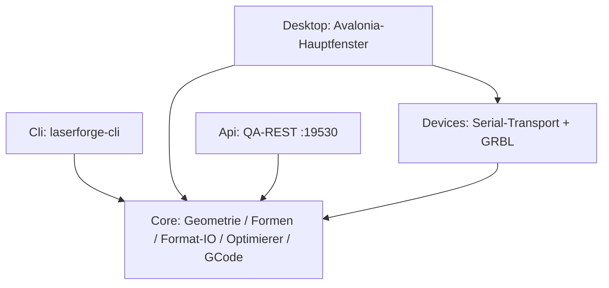

# Architektur — LaserForge

Kern-Entscheidungen: Core ohne Fremdpakete (BCL) — alles auf Zug/SchnittEinstellung/Projekt;
legacy-Format als Schreibnorm; GRBL mit M4/S-Skala/mm-min; Transport-Abstraktion fuer spaetere
Protokolle; QA-Harnisch am Stand-PC via schtasks + PrintWindow-DWM.
Funktionstabelle: docs/parity-checklist.md.
